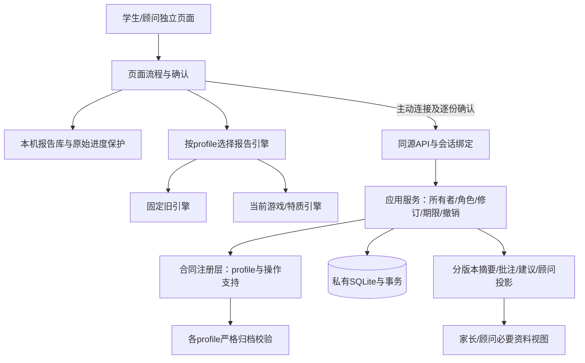

# 架构现状与调整顺序（2026-10-26）

推荐继续采用**静态离线前端 + 可选FastAPI模块化单体**。优先集中测评版本、严格归档合同和各项操作支持范围；现有页面、SQLite、账号权限及离线使用方式继续保留。本轮先交付这层基础，新版云端保存仍待下一段端到端接入。

## 当前已完成到哪里

PR #5、#6、#8均已由仓库所有者合并；本轮从最新main `6d533f0` 开始，业务基线为v1.16.0。原main额外仅修改协作说明的线上地址，没有需要重复开发的游戏功能。实际生产是否拉取到这些提交未在本机核验。

| 范围 | 原测评profile | 游戏/特质profile |
|---|---|---|
| 本机续答、报告/PDF、顾问本机文字编辑 | 已支持，保留原义 | 已支持 |
| JSON归档 | 纯旧v1保持 | 明确标记记录使用v2 |
| 云端保存与既有协作/摘要/统计 | 原合同支持 | 当前仍拒绝 |
| 独立后端严格模型 | 既有ArchiveRecord保持 | 本轮新增合同基础，未接owner API |
| 按操作说明兼容性 | 本轮统一到注册层 | 本轮operations为空，不授业务能力 |

原profile为14道规划/13必答/24个数字量表；新profile为13道规划/12必答/30个对象量表。学术bank2026.10仍只是学术60题版本，不能代表两代规划/性格含义一致。详细产品清单见 [开发交接](development-handoff.md)，术语见 [GLOSSARY](../GLOSSARY.md)。

## 为什么先调整合同

目前浏览器流程、云客户端和本机库分别维护版本辨认/校验，后端多个服务也直接依赖旧ArchiveRecord。此前同bank却改变规划和性格含义，已造成旧档案拒绝、分母变化和答案重解释风险；v1.16.0已先恢复旧档案保护。

下一阶段放开新归档前，还必须处理服务端投影。原共同家长snapshot builder只读取元数据并验证客户端摘要，不能依赖网页按钮来阻止新版使用旧分享/批注。顾问和文案入口也需要明确的操作支持检查。保存一份归档、允许分享摘要、允许顾问修改，应分别验收。

| 可选路线 | 收益与成本 | 决定 |
|---|---|---|
| 继续在各入口分散补版本条件 | 修改快，但合同容易漂移，后续每个入口都需重新推断 | 仅作为修复过渡 |
| 保留技术栈，集中合同与操作能力 | 维持file/离线、旧数据与部署方式；可逐项验证并减少重复判断 | 本轮采用 |
| 整体改组件框架或拆云服务 | 能重整复杂界面或独立扩容，但引入构建、数据迁移和多部署成本 | 等实际界面/容量需求支持后分别评估 |

决策及理由保留在 [ADR 0001](adr/0001-versioned-contracts-and-modular-monolith.md)。这是本次根据代码作出的工程选择，未假定团队已批准更换技术栈。

## 逻辑结构

操作能力是兼容性说明，不能替代登录或单报告授权；策略检查位于权限/源修订检查之后、生成新投影或写授权之前。现有历史快照、已授权讨论线程、名单和撤销仍按原生命周期管理，不因新增合同层而失去清理能力。

### 测评合同

`backend/tools/current-assessment-schema.cjs`从现有浏览器定义生成私有 `backend/current-assessment-schema.json` 和安全公开 `js/current-assessment-meta.js`。合同绑定有序30题及量表选项value/label、规划问句与选项含义、游戏解释/信号映射、量表版本和输入形状；不只验证“30题/0–4”。公开文件只有八键版本/指纹/计数，无学生资料或学术答案键。

语义指纹与规范LF源码溯源hash分开。同一profile的题序或答案含义改变时，生成器拒绝覆盖既有语义，要求定义新profile；仅注释/换行等不改变含义的来源调整可单独复核。普通生成遇基线缺失应失败；保留公开meta时必须核对原指纹锚，两份产物均缺时仅可显式首次--init，已发布profile丢文件须从Git恢复。指纹是部署一致性检查，不能认证历史数据、防篡改或教师审校。

`current_models.py`独立校验新版，不修改旧models.py。特别保留学术null、未出现字段、短数组、空/部分游戏、ms省略/null/任意有限数，以及顾问history/actor；不擅自把ms限定成非负整数或把UI展示池大小当归档总量。新合同延迟读取，坏新文件不能使旧API无法导入。

### 操作支持

`contracts.py`提供小接口：辨认profile、完整验证归档、检查指定操作、返回兼容性元数据。九个操作分别表示owner归档、家长摘要、新批注邀请、顾问读取、顾问文字编辑、文案草稿以及三个顾问摘要版本。legacy沿用已实现能力；CURRENT本轮均不开放。

新 `GET /api/report-capabilities`要求登录，发送X-CSRF时与当前Cookie绑定；返回no-store元数据。旧health仍精确API2，账号页和所有客户端默认连接没有新探测请求。此接口本轮供后续协商和本地验证使用，现有页面不会因发现新合同而自动启用新功能。

本轮集中的是后端合同与操作策略；浏览器现有轻量识别、本机库校验和账号客户端恢复保护暂时保留，避免在同一轮重写页面流程。下一段接入云归档时再统一消费生成元数据及明确能力，不能把兼容能力当账号权限。

原分享/邀请的共同builder、顾问、文案和汇总入口调用统一策略。完整源归档校验与公共元数据/摘要白名单各自保留；策略不重写原数据、不把“识别出了profile”当作通过完整校验。

### 应用与存储

应用服务继续负责身份、角色、源修订CAS、期限/撤销、容量和事务。`db.py`及schema5本轮不变；当前owner API仍只接受旧ArchiveRecord，新版提交继续拒绝。能力发现本身不写库、不读全校答卷。

后续启用新版CRUD时，须在同一更新事务内禁止跨profile覆盖同一报告，并核对合同/能力与用户确认。当前本机库已有跨profile保护，云端在本轮仍关闭新版入口，因此不会先放开一半流程。

### 上云前还要核对浏览器题序

现personality.js使用带状态的sort比较器按种子打散题目。本轮合同冻结的是当前生成出的有序定义，不证明所有JavaScript引擎会产生相同题序。ECMAScript对不一致比较器的排序结果不作跨实现保证，见 [SortIndexedProperties](https://tc39.es/ecma262/multipage/indexed-collections.html#sec-sortindexedproperties)。

因此新版上云前须核对实际浏览器题序/量表与合同；后续新profile应采用稳定题目ID和明确题序或一致的洗牌算法，不能直接重排已有v1答案。当前只运行Node/Chromium验证，未宣称Firefox/Safari等价；本轮CURRENT业务保持关闭，不把这一前提藏在默认启用中。

## 下一步如何拆分

1. **新版owner云归档。** 先核对浏览器题序，明确稳定ID/题序的版本策略，再接入独立模型、前后端能力指纹核对和完整创建/读取/修订更新/本机打开；验证旧端拒绝、原值往返、跨profile更新拒绝、所有权/CAS/配额及未知结果不重试。继续保持旧协作入口关闭新版。
2. **新版分享与协作。** 逐项定义新家长摘要、批注范围、顾问读取/编辑和文案上下文，单独验收授权、私密字段、期限/撤销和审计。旧只读许可不自动扩权。
3. **新版汇总与配对。** 显式版本化分母、0/null、部分规划、学生明确选择与游戏派生值，再适配CSV、本地统计和后续成绩工具。旧v1/v2/v3格式与指纹保持。
4. **按真实需求重整页面/部署。** 再将稳定的页面流程、请求生命周期与合同适配分别抽出；生产并发、共享限流、可信代理、备份恢复及人工内容审校依赖公司环境，不在缺证据时切换数据库或服务架构。

## 验证与限制

本轮实际结果和日志由 [持续台账](progress.md)记录；实施接口与门槛见 [本轮计划](architecture-plan-2026-10-26.md)。独立审查和完整回归后再交付，不以纯模型通过声称新版云归档已完成。没有真实样本校准、生产部署或外部模型调用。

Skill/MCP筛选与本次来源核对见 [工具使用约定](tooling-policy.md)。
